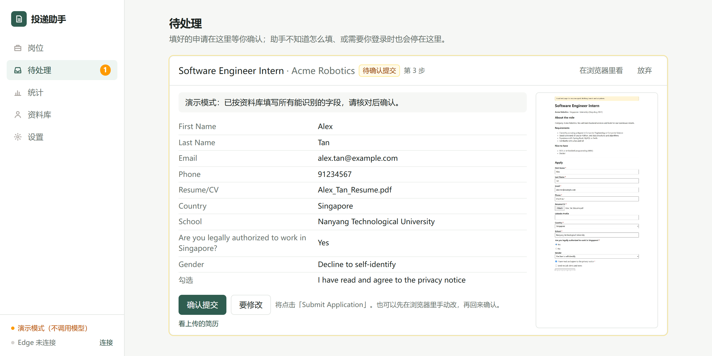
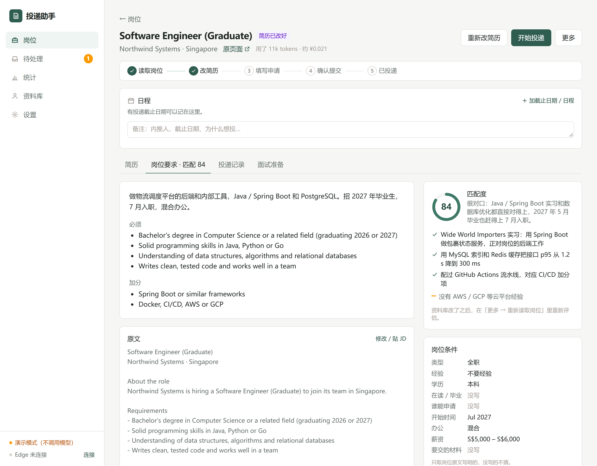
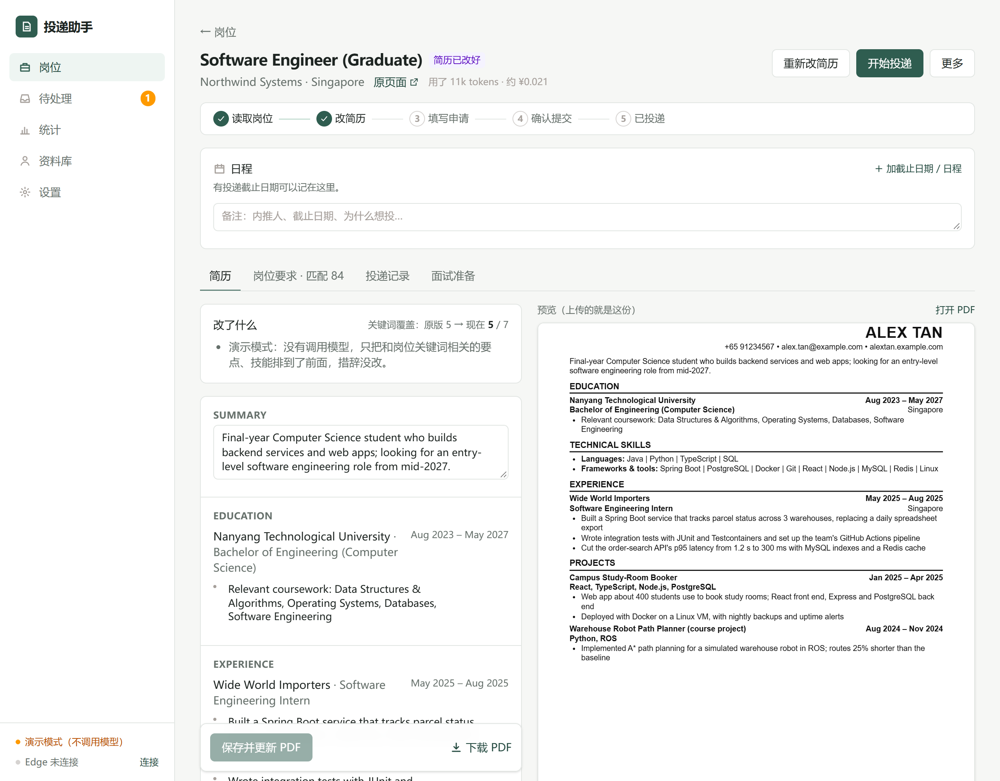

# Resume Agent (resume-agent)

[](https://github.com/PrinceCatt/resume-agent/actions/workflows/ci.yml)

A job-application helper that runs on your own computer: paste job links → it tailors your resume to each posting → an agent fills in the application form in your browser → **it stops before the submit button and waits for you to confirm**.

It reads each posting, scores the fit against your profile, tailors your resume using only facts from your profile (every new number or skill is checked against a source), and drives the application form in your own signed-in Edge or Chrome through the Playwright Extension. It never clicks the final submit button by itself: every application stops for your confirmation, and passwords, CAPTCHAs and sign-ins are always left to you. The model is DeepSeek (any OpenAI-compatible endpoint works), and a rule-based demo mode runs without a key. All data stays in a local `data/` folder. Requires Node 24 and pnpm. MIT licensed.

This is the English edition: everything in the app is in English.

> Job sites' terms often forbid automation tools, and heavy use can get an account restricted. You are responsible for how you use this; keep the volume low and review every application before confirming.

## Screenshots

The screenshots were taken from the Chinese edition, so the labels in them are in Chinese; the English edition has the same pages and layout.

Everything here is sample data: the person, companies and jobs are made up, and the fit notes were written for the demo rather than produced by the model. The application under "Waiting for you" was really filled in by the app, in demo mode, on its local test page.

**Job list**: once read, each posting gets a fit score and the conditions it states (full-time / part-time internship, experience, start date); upcoming interviews, tests and deadlines are on top.


**Waiting for you**: the agent fills in the form, stops before the submit button and lists what it entered, with a screenshot of the page, until you click "Confirm submit".



**Fit**: scored against your profile, with what matches, what is missing and the posting's conditions.



**Tailored resume**: built only from your profile by picking, reordering and rewording; the right side is the PDF that gets uploaded.



**Stats**: the application funnel, applications per week, and reply rates by fit score and by site.


**Cost**: estimated from DeepSeek's prices and the time of each call.


## Getting started

You need Node 24 and pnpm. Install the dependencies the first time:

```bash
pnpm install
```

- Windows: double-click `start.cmd`; your browser opens http://127.0.0.1:8791 .
- macOS / Linux: `pnpm serve` (builds the UI and starts the app), then open http://127.0.0.1:8791 .
- Development: `pnpm dev` (UI on http://127.0.0.1:5191 , API on :8791). Checks: `pnpm typecheck`, `pnpm test`.

It listens on this computer only (127.0.0.1) and accepts write requests only from pages on this computer.

## First use

1. **Settings**: add a DeepSeek API key (or switch to demo mode first and walk through the flow with "Add a local test job").
2. **Profile**: check what was imported from your resume; put internships and projects your resume leaves out into "Extra facts"; fill in "Common application questions" (work authorization, earliest start date and so on).
3. **Settings → Browser → Connect**: the agent fills forms in new tabs of the Edge you normally use, with the accounts you are already signed in to, and opens no separate window. The first time, install Playwright's [Playwright Extension](https://chromewebstore.google.com/detail/mmlmfjhmonkocbjadbfplnigmagldckm) in Edge (it is in the Chrome Web Store, where the page sometimes calls it Playwright MCP Bridge; Edge's own add-on store does not list it. Edge asks whether to allow extensions from other stores: choose Allow), then click "Connect" and click Allow on the connection page Edge opens. Clicking the Playwright Extension icon in the toolbar opens its status page, which shows a line `PLAYWRIGHT_MCP_EXTENSION_TOKEN=…`; copy it (the whole line is fine) into "Extension token" in Settings and you no longer need to click Allow when connecting.

Why an extension: since Edge / Chrome 136, the profile you normally use no longer allows remote debugging, so Playwright cannot attach to the browser you are using directly. The extension is the official way in (Playwright's extension mode: a local relay starts, and the extension hands the tabs it can control to Playwright). Reading public job pages and making PDFs still use an invisible background browser.

## What it does and does not do

- Tailoring takes material only from your profile: it may pick, reorder and reword; new numbers, new skills and bullets with no source are blocked or flagged for you to check.
- When filling a form, it asks you about required fields it doesn't know, and your answer can be saved to your profile.
- It never clicks the final submit button itself (Submit / Apply / 投递 / 立即沟通 and the like); it always stops and waits for your confirmation.
- It never types passwords and never deals with verification codes, Singpass or creating accounts; it stops and asks you to do these in the browser.
- When a site shows a bot check such as "Just a moment…", it stops and waits for you to pass it in that tab yourself; it never tries to get around it.
- It closes only the tabs it opened (when an application is finished or abandoned) and never touches your own tabs; disconnecting does not close your browser either.

## Job sites

Every site is filled in the generic way (look at the page, fill in the form, stop before the final submit). A few sites common in Singapore also come with hints about how their flow usually goes, which are given to the model when it opens one of their pages:

| Site | Reading postings | Applying | What you do yourself |
| --- | --- | --- | --- |
| LinkedIn | Readable without signing in | Easy Apply is filled in in its pop-up; jobs with only "Apply" continue on the company's site | Sign in |
| JobStreet | Read in a tab of your Edge (reading in the background hits a bot check) | Quick apply in four steps: documents, employer questions, profile (left unchanged), submit | Sign in, bot checks |
| Glassdoor | Same as above | Easy Apply goes to Indeed's application form (in a new tab) | Sign in, bot checks |
| Indeed | Same as above | Apply now is filled in on Indeed | Sign in, email codes |
| MyCareersFuture | Readable without signing in | Fill in the form after signing in | Singpass sign-in |
| Workday (common on company sites) | — | Autofill from the resume, then check each field | One account per company |

Being signed in to these sites in your Edge is enough (Settings lists their sign-in pages), so a batch of applications doesn't stop at each one to wait for you to sign in.

Status (2026-11): on real sites it has only reached the confirmation page on LinkedIn Easy Apply (no application has actually been submitted yet); real applications on the other sites have not been tried. LinkedIn's 2026 Easy Apply puts the question in each option's aria-label and the option text in a `<p>` next to it; on the first run the agent swapped "Yes" and "No", which is fixed, and the mock page now has a question built the same way. Also verified: real LinkedIn and MyCareersFuture job pages are read in full, and three local mock pages modelled on their flows (`fixtures/site-*.html`: a multi-step form in a pop-up, a four-step form with a bot check, and a form filled in a new tab that closes itself) are each filled from start to submit with DeepSeek. Buttons and steps on real sites change, so keep an eye on the first application you send on a given site.

These sites' terms usually forbid automation tools, and heavy use can get an account restricted: every application is submitted only after you confirm it, keep the volume low, and "Applications at a time" set to 1 is the safest.

## Other features

- **Finding jobs**: switch the add box on the Jobs page to "Search jobs": enter keywords (comma-separated, each searched separately), choose full-time (entry level) / part-time / internship and how recently posted, and search LinkedIn (Easy Apply only by default) and MyCareersFuture. A job on both sites is listed once, jobs already in your list are marked, and titles with Senior / Lead / Manager / 5+ years are left out by default. The results are only a list: a job is read and scored once you tick it and add it. LinkedIn is searched the way a signed-out visitor sees it, and searching too often gets you blocked for a while (you are told to try again in a few minutes). LinkedIn's "entry level" filter is loose, and MyCareersFuture has plenty of sales jobs with "Fresh grads" in the title, so skim before adding.
- **Job conditions and filters**: reading a posting saves the conditions the posting itself states: full-time / part-time / internship (internships split into full-time and part-time, and how many months), minimum years of experience, education, whether it wants current students or graduates, whether it is open to citizens / PR only, start date, salary, and documents to send (cover letter, transcript, portfolio, references). Whatever the posting doesn't say is "Not stated"; nothing is guessed. Each row in the list shows these conditions (2+ years of experience, graduates only and citizens only are in yellow), with a row of filters above: type (full-time / part-time internship / full-time internship / part-time; an internship with no hours stated counts as both), maximum experience, whether it asks for a cover letter, fit, and hiding citizens-only / graduates-only / closed jobs. "Requirements" counts types, experience, restrictions and documents to send under the current filters, along with the most-asked skills (✓ = in your profile); click a skill to see only the jobs that ask for it. Jobs read before this feature have no conditions; "Re-read job" adds them.
- **Fit**: reading a posting also scores it against your profile (0–100) and lists what matches and what is missing; the list can be sorted by fit. A tool mentioned under strengths that your profile doesn't have (it understands spellings like ROS = Robot Operating System and Vue = Vue3) is marked in yellow, with a note that the score may be too high. Settings has a minimum: when you paste many links at once, jobs below it stop after being read, with no automatic tailoring or applying. The automatic flow runs only after the first read; later, "Re-read job" refreshes only the posting and the fit, and never tailors again or applies a second time. When your "Common questions" in the profile say what you are looking for (for example mainly full-time entry-level roles, part-time internships second) and when you graduate, scoring takes them into account: for someone who wants part-time internships, a full-time internship is a conflict however well the dates fit. The conflict is shown on the job's row and on the fit card, and the score is capped at 45 (the app enforces this; the model on its own often doesn't lower the score). Only four kinds of conflict count, and only when the posting states them: a full-time internship (full-time hours stated), a start date that doesn't fit, graduates only, and citizens / PR only. A full-time job is assumed to start after graduation, so still studying costs nothing unless the posting says you must start before graduating or already hold the degree.
- **Cover letters**: with "Write one for every job" off in Settings, letters are written only for postings that ask for one (when the posting says what to cover, such as "why you want to join", it answers from the facts in your profile); when a form asks for a cover letter upload and the job doesn't have one yet, the agent writes one on the spot and uploads it. When the cover letter box on a job page is empty, you can click "Write one". Numbers in a cover letter with no source in your profile are flagged for you to check.
- **Following up after applying**: applied jobs can be marked with their progress (Awaiting reply / Assessment / Interviewing / Offer / Rejected / Withdrawn), and each job can have notes; you get a hint when an application has had no news for two weeks.
- **Duplicate links**: pasting the same job again (even with different tracking parameters) doesn't add it twice and opens the existing one instead. You can paste a whole job-alert email too; the links are picked out of it.
- **Live view**: while a form is being filled, its card shows the current page in the agent's tab, refreshed at every step; afterwards the view where it stopped is kept, which helps when looking into a failure.
- **Notifications**: once turned on in Settings, a system notification appears when an application is waiting for your confirmation or an answer; the tab title also shows how many are waiting for you.
- **Export**: "Export" at the top right of the Jobs page gives a spreadsheet that opens directly in Excel, with columns for type, experience, education, restrictions, documents to send and salary.
- **Usage and cost**: Settings shows how many tokens were used today / this month / in total and roughly what they cost (estimated from DeepSeek's November 2026 prices and whether each call fell in peak or off-peak hours; DeepSeek's own billing is what counts), split by purpose; each job page also shows what that job cost. How it saves money: only the body of a posting goes to the model (LinkedIn's sign-in menu, "Similar jobs" and "People also viewed", and the cookie notice and footer on older MyCareersFuture pages are removed first, cutting a posting from about 24,000 characters to about 3,000); your profile goes at the very start of the prompt, identical every time, so DeepSeek bills it at the cache price (about a tenth). When the posting, your profile and the prompt haven't changed, "Re-read job" reuses the last result without calling the model; it reads again only when something changed. While filling a form: when the page only got values filled in and its structure didn't change, only the changed fields are sent (about 70 tokens instead of re-sending the whole page at about 3,000), and the full snapshot stays in the conversation and is served from the cache; in a full snapshot, ordinary buttons and links outside the form (similar-jobs lists, navigation menus) are capped at 40 (15 while a pop-up is open), while form fields, buttons inside the form and apply / next / submit buttons are all kept, and after the model scrolls or an action fails, the next step lists everything. The rules and your profile come first in the form-filling prompt and the date last, so the next application is served from the cache too. Everywhere the model returns JSON, it is asked to keep it on one line (output costs four times uncached input, and indentation and line breaks count as tokens).
- **When the balance runs out**: Settings shows your DeepSeek account balance (from DeepSeek's balance API, which is free); the app checks it once at startup. When the balance is too low, or DeepSeek answers a call with 402, the app is marked as out of balance: reading, tailoring and form filling all pause instead of calling and failing one by one, and jobs waiting for off-peak hours keep waiting; a red strip appears at the top of the Jobs page. After topping up, click "Topped up, continue": the balance is checked again, and if it is enough, the jobs paused for lack of balance carry on (unfinished reads start over; jobs sent through Process carry on with tailoring and form filling). Changing the API key or the base URL checks again too.
- **Save money: wait for off-peak hours** (Settings → Applying, off by default): DeepSeek charges peak prices on weekdays 9–12 and 14–18 (Beijing time, the same as Singapore) and half price the rest of the time. When on, tailoring and form filling from Process and the automatic flow wait during peak hours (the job shows "Off-peak · 12:00") and start by themselves when peak hours end; even off-peak, the next one starts only when a slot is free, so no long queue spills into the next peak. Reading jobs doesn't wait (it is cheap, and the fit depends on it), and neither do the buttons on a single job; "Run now" starts the waiting jobs right away, and their remaining steps don't wait either. Work already running is never interrupted. Public holidays count as ordinary weekdays, which can only mean waiting longer, never spending more. The waiting state is stored in the database, so it carries on waiting after the app restarts.
- **Board**: the top right of the Jobs page switches to a board with columns Preparing / Awaiting reply / Assessment / Interviewing / Offer / Ended; dragging a card changes its progress (on a phone, use the drop-down under the card).
- **Schedule and reminders**: record interviews, tests, calls and application deadlines on a job's page; "Coming up" at the top of the Jobs page lists them. While the page is open you get reminders (an hour before an interview or test, a day before a deadline), and you can download an .ics file to add it to Outlook or your calendar. Recording an interview or a test moves the job's progress forward automatically.
- **Interview prep**: "Interview prep" on a job's page has likely questions with experiences you can talk about (think first, then open them), a 30-second self-introduction, questions to ask the interviewer, and how to talk about gaps. As with tailoring, it uses only facts from your profile: every point about your experience names its source (which entry in your profile), and a point whose source doesn't exist, or that mentions tools or numbers your profile doesn't have, is marked in yellow with "Don't repeat it as written"; advice on answering is marked "Approach" separately. These checks are redone against your current profile whenever the page opens, so filling in your profile turns them green without writing the prep again. Email drafts and the self-introduction get the same checks.
- **Email drafts**: a follow-up email (when an application has had no reply) and a thank-you note after an interview, which you can copy or open in your mail app.
- **Stats**: the application funnel, reply rate, how many days replies take, how many you applied to each week, and reply rates grouped by fit and by job site (useful for setting the minimum fit).
- **Profile**: the top lets you jump to each part; under "Common questions" there are templates for frequently asked questions, plus questions you were asked while filling forms but haven't saved to your profile yet, which you can add with one click.

## Data

Everything is in `data/` (gitignored): `app.db` (profile, jobs, application records, schedule, progress history, interview prep, API key, token usage), `files/` (each job's resume and cover letter PDFs) and `shots/` (screenshots of forms before confirmation and views of the filling process). Your sign-ins to websites stay in your own browser and are not stored here; the extension token, like the API key, is stored only in `app.db` and never sent to the UI. Deleting a job also deletes its PDFs and screenshots.

## Structure

- `server/agent.ts` — form-filling agent: look at the page → DeepSeek tool call → act; `isFinalSubmit` is the submit gate
- `server/tailor.ts` — resume tailoring + source checks (`assemble`)
- `server/observe.ts` — page snapshots (all frames, form controls, buttons)
- `server/jobs.ts` — reads job pages, extracts requirements, keywords and job conditions (`facts`)
- `src/reqs.ts` — labels, filters and stats for job conditions (shared by the list, the export and the tests)
- `server/cost.ts` — works out what each call cost from the price list and the time of the call
- `server/batch.ts` — off-peak hours and free slots for batch tailoring and form filling; `src/offpeak.ts` decides what counts as peak hours (shared by server and UI)
- `server/discover.ts` — finding jobs: LinkedIn's public search and MyCareersFuture search, removing duplicates and marking jobs already in the list
- `server/browser.ts` — connects to your own Edge (through the Playwright Extension) and opens and closes only its own tabs; a background browser reads public pages and makes PDFs
- `server/mock.ts` — rule-based stand-ins for demo mode
- `server/schedule.ts` — schedule (interviews, tests, deadlines) and .ics
- `server/prep.ts` — interview prep and email drafts
- `server/terms.ts` — checks whether what the model wrote names tools your profile never mentions
- `server/sites.ts` — flow hints, sign-in pages and bot-check detection for each job site
- `server/stats.ts` — numbers for the Stats page, and questions asked while filling forms
- `server/core.test.ts` — tests for the submit gate, source checks, duplicate links, follow-up, schedule moving progress forward, stats, asked questions, parsing and de-duplicating job search results, checking and filtering job conditions, when to write a cover letter, peak hours and off-peak waiting, sending only changes while filling forms, and re-reading without paying twice (`pnpm test`)
- `fixtures/test-job.html` — a job page for local testing
- `fixtures/site-*.html` — local mock pages modelled on the LinkedIn / JobStreet / Glassdoor→Indeed flows (not the real sites, and without their logos)

## License

[MIT](LICENSE). See [CHANGELOG.md](CHANGELOG.md) for what changed.
