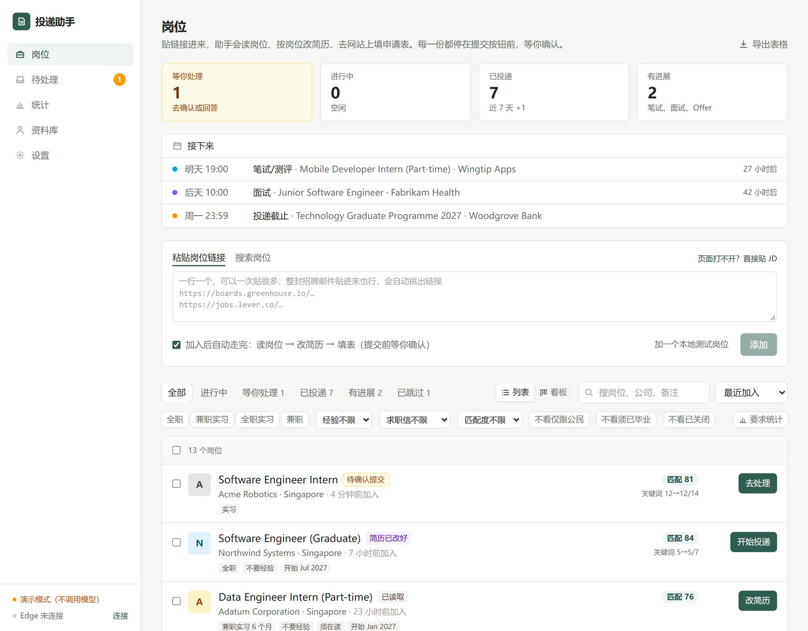
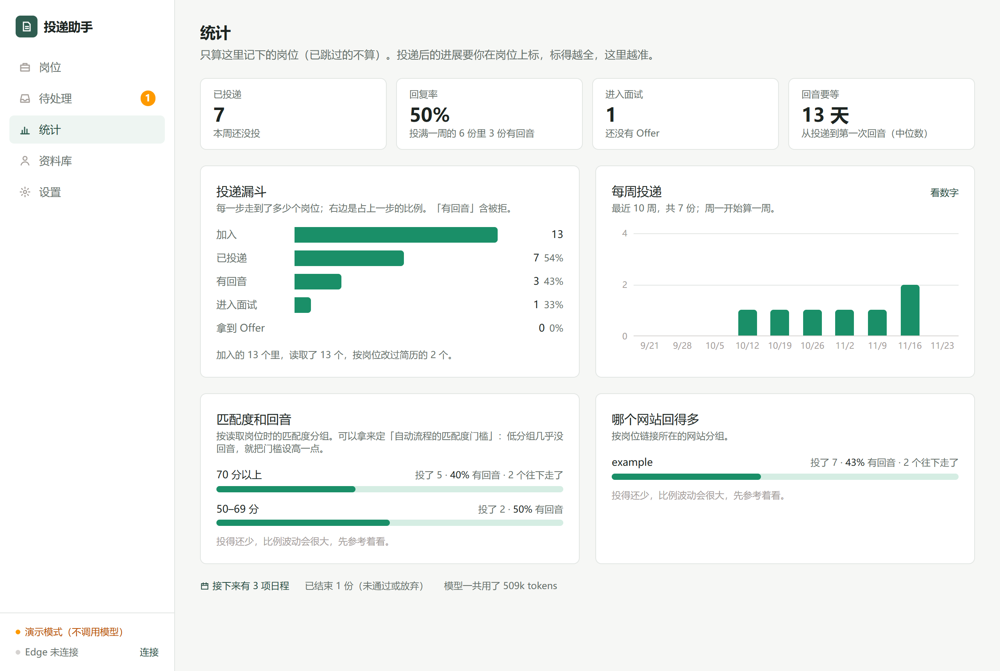

# 投递助手（resume-agent）

[](https://github.com/PrinceCatt/resume-agent/actions/workflows/ci.yml)

本地运行的求职助手：贴岗位链接 → 按岗位改简历 → agent 在浏览器里填申请表 → **停在提交按钮前等你确认**。

**English summary.** A job-application helper that runs on your own computer. Paste job links; it reads each posting, scores the fit against your profile, tailors your resume using only facts from your profile (every new number or skill is checked against a source), and drives an application form in your own signed-in Edge or Chrome through the Playwright Extension. It never clicks the final submit button by itself: every application stops for your confirmation, and passwords, CAPTCHAs and sign-ins are always left to you. The model is DeepSeek (any OpenAI-compatible endpoint works), and a rule-based demo mode runs without a key. All data stays in a local `data/` folder. The UI is in Chinese. Requires Node 24 and pnpm. MIT licensed.

> Job sites' terms often forbid automation tools, and heavy use can get an account restricted. You are responsible for how you use this; keep the volume low and review every application before confirming.

## 截图 / Screenshots

截图里的人、公司、岗位都是虚构的，匹配度说明等文字是为演示写的示例，不是模型的输出；「待处理」里那份申请表是程序在演示模式下真的在本地测试页上填的。

Everything here is sample data: the person, companies and jobs are made up, and the fit notes were written for the demo rather than produced by the model. The application in 待处理 was really filled by the app, in demo mode, on its local test page.

**岗位列表 / Job list**：每个岗位读完后有匹配分和岗位写明的条件（全职 / 兼职实习、经验、开始时间），上面是接下来的面试、笔试和截止日期。Each posting gets a fit score and the conditions it states; upcoming interviews, tests and deadlines are on top.



**待处理 / Waiting for you**：agent 填完申请表，停在提交按钮前，列出填了什么、附上页面截图，等你点「确认提交」。The agent fills the form, stops before the submit button and shows what it entered, with a screenshot of the page.


**匹配度 / Fit**：对照资料库打分，列出对得上的和缺的，以及岗位条件。Scored against your profile, with what matches, what is missing and the posting's conditions.


**按岗位改简历 / Tailored resume**：只用资料库里的内容挑选、排序、换说法，右边是会上传的 PDF。Built only from your profile; the right side is the PDF that gets uploaded.


**统计 / Stats**：投递漏斗、每周投递、按匹配度和网站分组的回复率。Funnel, applications per week, and reply rates by fit score and by site.



**花费 / Cost**：按 DeepSeek 价目和每次调用所在的时段估算。Estimated from DeepSeek's prices and the time of each call.


## 启动

需要 Node 24 和 pnpm。第一次先装依赖：

```bash
pnpm install
```

- Windows：双击 `start.cmd`，浏览器会打开 http://127.0.0.1:8791 。
- macOS / Linux：`pnpm serve`（构建界面并启动），然后打开 http://127.0.0.1:8791 。
- 开发：`pnpm dev`（界面 http://127.0.0.1:5191 ，接口 :8791）。检查：`pnpm typecheck`、`pnpm test`。

只监听本机（127.0.0.1），并且只接受本机页面发来的写请求。

## 第一次用

1. **设置**：填 DeepSeek API key（或先切到演示模式，用「加一个本地测试岗位」走一遍流程）。
2. **资料库**：核对从简历里录入的内容；把简历上没写的实习、项目写进「素材库」；填好「申请表常见问题」（工作许可、可入职时间等）。
3. **设置 → 浏览器 → 连接**：助手在你平时用的 Edge 里开标签页填表，用的是你已经登录的账号，不另开窗口。第一次要在 Edge 里装 Playwright 的扩展 [Playwright Extension](https://chromewebstore.google.com/detail/mmlmfjhmonkocbjadbfplnigmagldckm)（在 Chrome 应用商店里，商店页面上有时叫 Playwright MCP Bridge；Edge 自己的扩展商店搜不到。Edge 会问是否允许来自其他商店的扩展，选允许），然后点「连接」，在 Edge 打开的连接页上点允许。点工具栏里 Playwright Extension 的图标会打开它的状态页，上面有一行 `PLAYWRIGHT_MCP_EXTENSION_TOKEN=…`；复制（整行也行）填进设置的「扩展令牌」，以后连接就不用点允许。

为什么要装扩展：Edge / Chrome 136 起，平时用的那个资料目录不再允许远程调试，Playwright 没法直接接上正在用的浏览器；扩展是官方给的接法（Playwright 的 extension 模式：本地起一个中转，扩展把它能控制的标签页转给 Playwright）。读公开的岗位页和生成 PDF 仍用一个看不见的后台浏览器。

## 它会做 / 不会做

- 改简历只从资料库取材料：可以挑选、排序、换说法；新出现的数字、技能、找不到出处的要点会被拦下或标出来让你核对。
- 填表时不知道的必填项会问你，回答可以记进资料库。
- 不会自己点最终提交（Submit / Apply / 投递 / 立即沟通 等），一律停下等你确认。
- 不会输入密码、不会处理验证码 / Singpass / 注册账号，这些会停下叫你在浏览器里做。
- 网站弹出「Just a moment…」这类人机验证时会停下，等你自己在那个标签页上过；不会去绕过。
- 只关自己开的标签页（填完、放弃时），不碰你自己的标签页；断开连接也不会关你的浏览器。

## 招聘网站

任何网站都按通用方式填（看页面、填表、到最终提交前停下）。新加坡常用的几个另外带了「这个网站的流程一般怎么走」的提示，打开这个网站的页面时加给模型：

| 网站 | 读岗位 | 投递 | 要你自己做的 |
| --- | --- | --- | --- |
| LinkedIn | 没登录也能读 | Easy Apply 在弹窗里填完；只有「Apply」的跳到公司官网接着填 | 登录 |
| JobStreet | 在你的 Edge 里开标签页读（后台读会被人机验证挡住） | Quick apply 四步：文件、雇主问题、资料（不改）、提交 | 登录、人机验证 |
| Glassdoor | 同上 | Easy Apply 转到 Indeed 的申请表（新标签页） | 登录、人机验证 |
| Indeed | 同上 | Apply now 在 Indeed 里填完 | 登录、邮箱验证码 |
| MyCareersFuture | 没登录也能读 | 登录后填表 | Singpass 登录 |
| Workday（公司官网常见） | — | 用简历自动填，再逐项核对 | 每家公司各建一个账号 |

在你的 Edge 里登录过这几个网站就行（设置页列了登录页链接），批量投的时候就不会一份份停下来等你登录。

现状（2026-11）：真实网站上只在 LinkedIn Easy Apply 填到过确认页（还没真正提交过一份），其他几个网站的真实投递还没跑过。LinkedIn 2026 年的新版 Easy Apply 把问题写在每个选项的 aria-label 里、选项文字放在旁边的 `<p>` 里，第一次跑时助手把「是 / 否」认反了，已经修好，模拟页里也照着加了一题。验证过的还有：真实的 LinkedIn 和 MyCareersFuture 岗位页能读出完整内容；三个仿照它们流程做的本地模拟页（`fixtures/site-*.html`，弹窗里的多步表单、带人机验证的四步表单、在新标签页里填完会自己关掉的表单）用 DeepSeek 都能从头填到提交。真实网站的按钮和步骤会变，第一次在某个网站投的时候盯一下。

这些网站的用户协议一般不允许自动化工具，用多了账号有被限制的风险：每份都是你确认才提交，量别太大，「同时填几份」设 1 最稳。

## 其他功能

- **找岗位**：岗位页「添加」框切到「搜索岗位」：填关键词（逗号分隔，每个分别搜），选全职（入门级）/ 兼职 / 实习和发布时间，从 LinkedIn（默认只要 Easy Apply）和 MyCareersFuture 搜。两边同一个岗位只列一次，已经在列表里的标出来；默认不列标题里有 Senior / Lead / Manager / 5+ years 的。搜出来只是列表，勾选后加入才会读岗位、打分。LinkedIn 用的是没登录时看到的公开搜索，搜得太频繁会被暂时挡住（会提示「过几分钟再试」）。LinkedIn 的「入门级」筛选很松，MyCareersFuture 上也有不少拿「Fresh grads」当标题的销售岗，加入前扫一眼。
- **岗位条件和筛选**：读岗位时把岗位原文写明的条件存下来：全职 / 兼职 / 实习（实习分全职和兼职、几个月）、最少几年经验、学历、要在读还是要已毕业、是否仅限公民 / PR、开始时间、薪资、要交的材料（求职信、成绩单、作品集、推荐人）。原文没写的就是「没写」，不猜。列表每行下面显示这些条件（要 2 年以上经验、须已毕业、仅限公民标黄），上面一排筛选：类型（全职 / 兼职实习 / 全职实习 / 兼职，没写工时的实习两种都算）、经验上限、要不要求职信、匹配度、不看仅限公民 / 须已毕业 / 已关闭。「要求统计」按当前筛选数出类型、经验要求、限制、要交的材料，以及最常要求的技能（✓ = 你的资料库里有），点技能就只看要这个技能的岗位。这次之前读的岗位没有条件信息，点「重新读取岗位」就有。
- **匹配度**：读岗位时顺便按资料库打分（0–100），列出对得上的和缺的；列表可按匹配度排序。优势里提到资料库没有的工具（认得 ROS = Robot Operating System、Vue = Vue3 这类写法），会标黄并提示分数可能偏高。设置里可以设门槛，一次贴很多链接时，低于门槛的读完就停下，不自动改简历和投递。自动流程只在第一次读取后跑一次；之后「重新读取岗位」只刷新岗位内容和匹配度，不会再改简历、再投一次。资料库「常见问题」里写了想找什么（例如全职入门岗为主、兼职实习其次）和毕业时间时，打分会对照：要兼职实习的人遇到全职实习，不管日期多合适都算冲突，冲突写在列表那一行和匹配度卡片上，分数最多 45（这条由程序卡住，模型自己常常不扣分）。冲突只认四种，而且要岗位原文写明了才算：全职实习（写明全职工时）、开始时间对不上、只招已毕业、只招公民 / PR；全职工作默认是毕业后入职，还在读书不扣分，除非岗位写明了毕业前就要到岗或要求已经拿到学位。
- **求职信**：设置里「所有岗位都写一封」关掉时，只给岗位写明要求求职信的写（岗位要求写什么，比如「为什么想加入」，就按资料库里的事实回答）；填表时表单要求上传求职信、而这个岗位还没有的，助手会现写一封再传。岗位详情的求职信框空着时可以点「写一封」。求职信里出现资料库找不到出处的数字会标出来让你核对。
- **投递后跟进**：已投递的岗位可以标进展（等回音 / 笔试测评 / 面试中 / Offer / 未通过 / 我放弃了），每个岗位可以写备注；投了两周没动静会提示。
- **重复链接**：同一个岗位再贴一次（哪怕带着不同的跟踪参数）不会重复加，会直接打开已有的那个。整封招聘邮件贴进来也行，会自动挑出链接。
- **实时画面**：填表时卡片上显示助手那个标签页的当前页面，每一步刷新；结束后保留停下时的画面，失败时方便看原因。
- **通知**：设置里打开后，有申请等你确认或回答时弹系统通知；标签页标题上也会显示等你处理的数量。
- **导出表格**：岗位列表右上角「导出表格」，Excel 可以直接打开；带上类型、经验要求、学历、申请限制、要交的材料、薪资几列。
- **用量和花费**：设置页显示今天 / 本月 / 总共用了多少 token、约多少钱（按 DeepSeek 2026 年 11 月价目和每次调用所在的高峰 / 闲时估算，以 DeepSeek 后台账单为准），按用途分开；每个岗位详情页也有这个岗位花了多少。省钱的做法：发给模型的只有岗位正文（LinkedIn 页面上的登录菜单、「Similar jobs」「People also viewed」，MyCareersFuture 旧页面的 cookie 提示和页脚都先去掉，岗位文字从约 24,000 字缩到 3,000 字左右）；资料库放在提示词最前面，每次都一样，DeepSeek 会按缓存价计费（约十分之一）。岗位内容、资料库和提示词都没变时，「重新读取岗位」直接沿用上次的结果，不调用模型；变了才重新读。填表时：页面只是填了值、结构没变，就只发变了的那几个字段（约 70 tokens，不再重发整页约 3,000 tokens），整页那份留在对话里走缓存；整页快照里，表单外的普通按钮和链接（相似岗位列表、导航菜单）最多列 40 个（弹窗打开时 15 个），表单字段、表单里的按钮和申请/下一步/提交类按钮一个不少，模型滚动一次或操作出错后下一步会列全。规则和资料库放在填表提示词前面、日期放到最后，下一份申请也能走缓存。要模型返回 JSON 的地方都要求压成一行（输出价是未命中输入的 4 倍，缩进和换行也算 token）。
- **余额用完时**：设置页显示 DeepSeek 账户余额（DeepSeek 的余额接口，不花钱）；程序启动时先查一次。余额不够、或调用时 DeepSeek 回 402，就标成「余额不足」：之后读取、改简历、填表都先停下，不再一个个调用、一个个报错，排着等闲时的也继续等着；岗位页顶上出现红条，充值后点「充好了，继续」——再查一次余额，够了就把因余额停下的岗位接着做（没读完的重新读，一键处理过的接着改简历、填表）。换 API key 或接口地址也会重新查。
- **等闲时再处理**（设置 → 投递，默认关）：DeepSeek 工作日 9–12 点、14–18 点（北京时间，和新加坡一样）是高峰价，其余时间半价。打开后，一键处理和自动流程里的改简历、填表在高峰时段先排着（岗位显示「等闲时 · 12:00」），到点自动开始；闲时也只在有空位时才开始下一个，所以不会有一大串排进下一个高峰。读取岗位不等（便宜，而且要靠它看匹配度），单个岗位上点按钮也不等；「现在就跑」让排着的岗位马上开始，剩下的步骤也不再等。已经在跑的不会被打断。节假日按平常工作日算，只会多等，不会多花。等待状态存在数据库里，程序重启后照样接着等。
- **看板**：岗位页右上角可以切到看板，按「准备中 / 等回音 / 笔试 / 面试 / Offer / 已结束」分列，拖卡片就是改进展（手机上用卡片下面的选择框）。
- **日程和提醒**：岗位详情里记面试、笔试、电话、投递截止；岗位页顶部「接下来」会列出来。页面开着时会提醒（面试/笔试前 1 小时，截止前 1 天），也可以下载 .ics 加到 Outlook / 日历。记了面试或笔试，进展会自动往前推。
- **面试准备**：岗位详情的「面试准备」：可能被问的问题和可以讲的经历（先自己想，再点开看）、30 秒自我介绍、可以反问的问题、短板怎么说。和改简历一样，只用资料库里的事实：每条讲经历的要点都标出处（资料库哪一条），出处不存在、或提到资料库没有的工具和数字，就标黄「别照着说」；答题方法单独标「思路」。这些检查在打开页面时按当前资料库重算，补完资料库就会变绿，不用重新生成。邮件草稿和自我介绍也做同样的检查。
- **邮件草稿**：跟进邮件（投了没回音）和面试后感谢信，可以复制或直接用邮件 App 打开。
- **统计**：投递漏斗、回复率、回音要等几天、每周投了多少，以及按匹配度、按招聘网站分组的回复率（拿来定匹配度门槛）。
- **资料库**：顶部可以跳到各部分；「常见问题」下面有常问问题模板，以及填表时问过你、还没记进资料库的问题，一键记进来。

## 数据

全部在 `data/`（已 gitignore）：`app.db`（资料库、岗位、投递记录、日程、进展记录、面试准备、API key、token 用量）、`files/`（每个岗位的简历和求职信 PDF）、`shots/`（确认前的表单截图和填表过程的画面）。网站的登录状态在你自己的浏览器里，这里不存；扩展令牌和 API key 一样只存在 `app.db`，不会发给界面。删除岗位时会一起删掉它的 PDF 和截图。

## 结构

- `server/agent.ts` — 填表 agent：看页面 → DeepSeek 工具调用 → 执行；`isFinalSubmit` 是提交拦截
- `server/tailor.ts` — 改简历 + 出处校验（`assemble`）
- `server/observe.ts` — 页面快照（所有 frame、表单控件、按钮）
- `server/jobs.ts` — 读岗位页、提取要求、关键词和岗位条件（`facts`）
- `src/reqs.ts` — 岗位条件的标签、筛选和统计（列表、导出表格、测试共用）
- `server/cost.ts` — 按价目和调用时段算每次调用花了多少钱
- `server/batch.ts` — 批量处理的改简历、填表等 DeepSeek 闲时和空位；`src/offpeak.ts` 是高峰时段的判断（前后端共用）
- `server/discover.ts` — 找岗位：LinkedIn 公开搜索和 MyCareersFuture 搜索，去重、标出已在列表的
- `server/browser.ts` — 接你自己的 Edge（经 Playwright Extension），只开关自己的标签页；后台浏览器读公开页、出 PDF
- `server/mock.ts` — 演示模式的规则版替身
- `server/schedule.ts` — 日程（面试、笔试、截止）和 .ics
- `server/prep.ts` — 面试准备和邮件草稿
- `server/terms.ts` — 查模型写的东西里有没有资料库没提过的工具名
- `server/sites.ts` — 各招聘网站的流程提示、登录页、人机验证识别
- `server/stats.ts` — 统计页的数字、填表时问过的问题
- `server/core.test.ts` — 提交拦截、出处校验、重复链接、投递跟进、日程推进进展、统计、问过的问题、找岗位的解析和去重、岗位条件的校验和筛选统计、求职信什么时候写、高峰时段和等闲时、填表只发变化、重读不重复花钱的测试（`pnpm test`）
- `fixtures/test-job.html` — 本地测试用的招聘页
- `fixtures/site-*.html` — 仿照 LinkedIn / JobStreet / Glassdoor→Indeed 流程的本地模拟页（不是真网站，没有它们的标志）

## Go 后端 / Go backend

`go/` 是 `server/` 的 Go 版（实验中）：同样的接口、JSON、事件流（`/api/events`）和 `data/app.db` 结构，界面不用改，两个版本可以轮流打开同一个 `data/`（不要同时开）。/ `go/` is a Go port of `server/` (experimental): same routes, JSON shapes, event stream and `data/app.db` schema, so the unchanged UI works against it and either backend can open the same `data/` (not both at once).

需要 Go 1.27+，以及 Edge 或 Chrome（无头模式出 PDF、读公开岗位页）。不需要 Playwright。/ Needs Go 1.27+ and Edge or Chrome (run headless for PDFs and public job pages); no Playwright.

```bash
pnpm dev:go                      # Go 接口 :8791（改了 .go 文件会重新编译）+ 界面 :5191
cd go && go build -o resume-agent . && ./resume-agent   # 只跑接口；先 pnpm build 就同时提供界面
cd go && go test ./... && go vet ./...
```

- 环境变量 / Environment: `PORT`（默认 8791）、`DATA_DIR`（默认仓库里的 `data/`）、`GO`（`go` 不在 PATH 上时给 `pnpm dev:go` 指路径）、`RA_BROWSER_PATH`（浏览器不在默认位置时）。
- 已移植 / Ported: 设置、资料库、岗位增删改、读岗位和匹配、导出表格、事件流、用量和统计；改简历、出处校验、求职信、PDF；填表 agent（页面快照、只发变化、提交拦截、问你 / 人工处理 / 确认前核对、截图）；找岗位（LinkedIn 公开搜索、MyCareersFuture）、日程和 .ics、面试准备、邮件草稿、等闲时、余额；演示模式；从 PDF 导入（pdf.js 在无头浏览器里跑，需要 `pnpm install` 过）。提示词和 TypeScript 版一字不差。/ Settings, profile, jobs, reading and scoring, CSV, events, usage and stats; tailoring, source check, cover letters, PDFs; the form-filling agent (snapshots, deltas, the final-submit gate, ask / manual / review before confirm, screenshots); job search, schedule and .ics, interview prep, email drafts, off-peak batching, balance; demo mode; PDF import. Prompts are copied verbatim.
- 没移植 / Not ported: 连接你自己的 Edge 的 Playwright 扩展中继。所以 Go 版现在不能在你的浏览器里填表；要自动填表请用 `pnpm dev`。开发时可以设 `RA_AGENT_HEADLESS=1`，让 agent 在无头浏览器里填本地的 `fixtures/` 测试页（只用于测试）。/ The Playwright-extension relay to your own Edge, so the Go backend cannot fill forms in your browser yet; use `pnpm dev` for that. For development, `RA_AGENT_HEADLESS=1` lets the agent fill the local `fixtures/` pages in a headless browser.
- 页面快照脚本 `go/app/observe.js` 由 `server/observe.ts` 生成（`cd go/app && go generate`），两边读页面的逻辑是同一份。/ The page-snapshot script is generated from `server/observe.ts`, so both backends read pages with the same code.

## 许可 / License

[MIT](LICENSE)。更新记录见 [CHANGELOG.md](CHANGELOG.md)。
